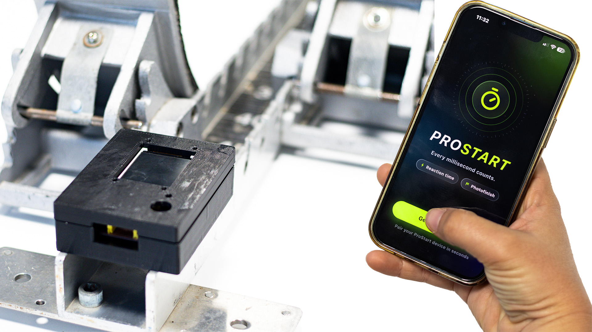

# Prostart

**Reaction time and photo finish for every track, for the price of a pair of spikes.**



A start unit that mounts on any starting block, and a phone app that turns a smartphone into a photo finish. The unit sounds the start commands, detects the push-off with an accelerometer and judges the start on its own clock; the phone times the chest crossing the line from the same "go".

Course project, Technology and Health, KTH Royal Institute of Technology, HT26: Arianna Bartocci, Duarte Chambel, Lorenzo Galli, Loke Enlund Östangård, Ninad Purekar. Full write-up: [`Papers/Final Paper/CM2024_Sprint_Start_Final_Paper.pdf`](Papers/Final%20Paper/CM2024_Sprint_Start_Final_Paper.pdf).

## How it works

```
 start unit (on the block)                           phone (at the finish)
 ESP32-C3 + BMI270, 803 Hz  ──── BLE: events, clock sync, run data ────  Flutter app, camera 240 fps
```

- **Start sequence.** Button → 3 s countdown → "on your marks" → "set" 20-25 s later → the unit waits until the athlete is still (< 15 mg for 200 ms) and fires "go" a random 0.7-1.5 s later. Each beep (4 kHz piezo) is started by two register writes and timestamped at that instant.
- **Onset detection.** Every accelerometer sample is timestamped in an interrupt (1 µs clock) and buffered in the sensor's FIFO, so radio traffic can delay a sample but never shift or lose it. Gravity is removed as a vector, so the mounting angle does not matter. An STA/LTA trigger decides *that* the athlete moved; an AIC picker then finds *when*, with no threshold, so the onset does not drift with the trigger level. Under 100 ms after "go" is a false start.
- **App.** *Reaction* mode mirrors the unit and saves every run as CSV. *Photofinish* mode syncs the phone's clock to the unit over BLE, films the line at the highest frame rate with a short exposure, finds the chest front with MediaPipe Pose and the body silhouette, and interpolates the crossing between frames. The time is rounded up to the hundredth, as the rules prescribe.

## Results

| | |
|---|---|
| Sampling | 803.2 Hz, no gaps, 0.9 µs timestamp jitter (2.8 µs with BLE connected) |
| Unit resolution | one sample, 1.2 ms; board and offline detector agree to the sample |
| Reaction time vs 240 fps video (LED at "go") | within ~8 ms, the resolution of the video reference |
| Finish time vs 60 fps reference | 10 ms (hand timing on the same runs: ~0.24 s fast) |
| Onset vs trigger threshold (10-50 mg, 79 starts) | same sample in 70 starts; a threshold-only detector drifts a median 9.3 ms |

**Limits.** Direct BLE reaches ~30 m; a full 100 m needs a finish relay (a second ESP32-C3 on long-range ESP-NOW, field-tested to 100-110 m). One athlete per run. The BMI270 filter delay and the sound's travel time (2.9 ms/m) are not yet measured.

## Hardware and cost

Parts for one start unit, one-off retail prices (estimates):

| Part | SEK |
|---|---:|
| ESP32-C3 SuperMini | 40 |
| BMI270 accelerometer breakout | 100 |
| 1.77" ST7735 TFT | 70 |
| Push button, 12 mm piezo, capacitors | 20 |
| Two-layer PCB (65.5 × 34 mm, batch of 5) | 30 |
| 3D-printed box, lid and button cap (PLA) | 15 |
| Strap to the block | 20 |
| **Total** | **≈ 295** |

For now the unit runs from a USB power bank; the next version will have a built-in LiPo cell and charger (~60 SEK more). The phone is the athlete's own. A single-block commercial reaction timer lists at about US$1,600 (~17,000 SEK); certified competition systems cost far more.

## Business plan

Customers: athletics clubs, school and university teams, coaches and individual sprinters who today time by hand.

| Product | Price | Notes |
|---|---:|---|
| Start unit | 1,290 SEK | ~350 SEK cost at 1,000 units incl. assembly and test: ~70 % gross margin |
| App, Free | 0 | Reaction time, run history, manual photo finish (tap the crossing frame) |
| App, Pro | 49 SEK/month or 399 SEK/year | AI photo finish, analysis of recorded videos, data export |
| Club plan | 1,990 SEK/year | Pro for up to 30 athletes, squad dashboard |

**Rough year-3 projection** (Nordics first, then Europe; assumptions, not market research):

| Line | Volume | Revenue (SEK) |
|---|---:|---:|
| Start units | 3,000 | 3.9 M |
| Pro subscriptions | 1,500 | 0.6 M |
| Club plans | 150 | 0.3 M |
| **Total** | | **≈ 4.8 M** |

Gross profit ≈ 3.7 M SEK after 1.05 M of unit cost, against ~1.5 M SEK/year for a small team (firmware, app, support), after an initial ~1 M SEK to build the finish relay, certify (CE/RED) and tool a moulded enclosure.

## Repository

```
Arduino/AlgorithmRealTimeESP32/  firmware (ESP32-C3 + BMI270, BLE); INFO.md: wiring, build, tests
Arduino/AlgorithmRealTime/       first prototype (XIAO nRF52840 Sense), same detector
Arduino/EspNowLrTest/            long-range ESP-NOW field test (finish relay)
Arduino/WifiFieldTest/           Wi-Fi range field test
prostart/                        Flutter app + native camera plugin (photo finish)
AI_Torso_Detector/               photo-finish reference in Python (MediaPipe)
Hardware/                        KiCad PCB, Gerbers, BOM; enclosure STL files
Data/                            block-start captures
Docs/                            algorithm, build and run notes, figures
Papers/                          final paper (LaTeX, PDF, slides), half-time paper
```

- **Firmware:** `arduino-cli compile --fqbn esp32:esp32:nologo_esp32c3_super_mini Arduino/AlgorithmRealTimeESP32` (ESP32 core 3.3.x), then `arduino-cli upload` with the same FQBN and `-p <port>`.
- **App:** `cd prostart && flutter pub get && flutter run` (iOS tested on an iPhone 13).

## License

All rights reserved: see [LICENSE](LICENSE). The code is visible for academic assessment only; no use, copy, modification or commercial use without the authors' written permission. Third-party code keeps its own license: `Arduino/libraries/Seeed_Arduino_LSM6DS3` (MIT), Bosch's BMI270 configuration in `Bmi270Config.h` (BSD-3-Clause).
